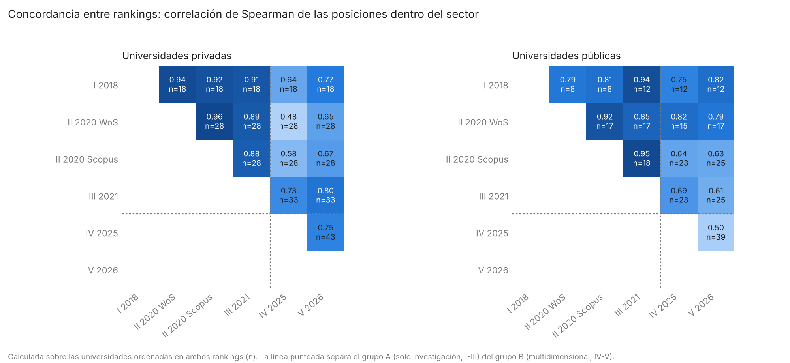
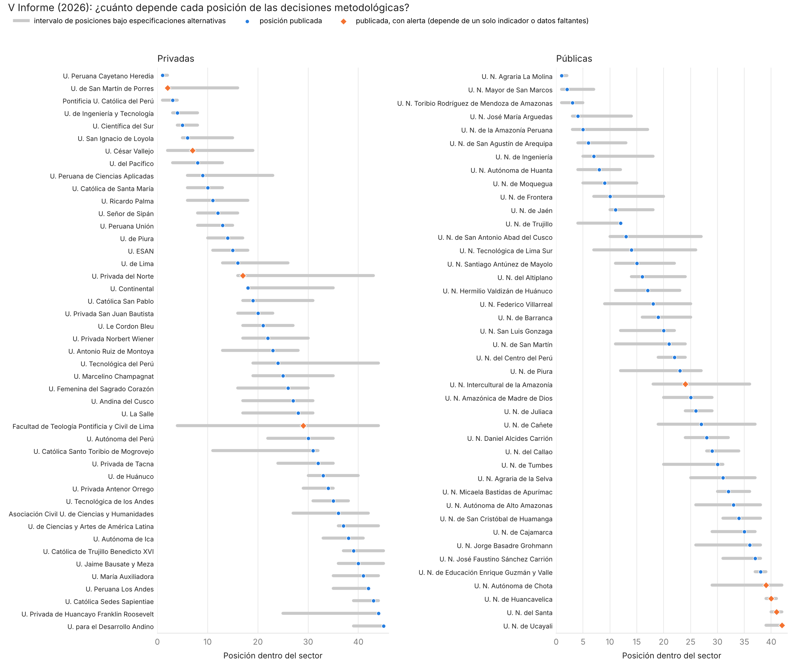

# sunedu_rankings

**Metodologías y serie histórica de los rankings universitarios de SUNEDU (2018–2026)**

La Ley Universitaria (Ley 30220, art. 15.15) obliga a la Superintendencia Nacional de Educación Superior Universitaria (SUNEDU) a publicar cada dos años un informe sobre la realidad universitaria que incluya un ranking. Hasta hoy hubo cinco ediciones. Sus rankings suelen leerse como una serie, del tipo "la universidad X subió del puesto 9 al 4", pero **cada edición usó una metodología distinta**.

Este repositorio tiene tres objetivos:

1. **Documentar con detalle cómo se construyó cada ranking**: indicadores, pesos, fuentes, ventanas temporales, universo y normalización, con la página de la fuente.
2. **Ofrecer una serie histórica armonizada**, con identificadores únicos por universidad y la transcripción literal de cada tabla publicada.
3. **Aclarar qué se puede afirmar realmente sobre el progreso de las universidades**: qué comparaciones son legítimas, qué posiciones resisten cambios metodológicos razonables y qué resultados merecen una revisión.

## Las cinco ediciones

| Edición | Publicación | Datos | Qué mide | Fuente bibliométrica | Ranking | Universidades ordenadas | Grupo |
|---|---|---|---|---|---|---|---|
| I | 2018 | 2014–2016 | Investigación: 4 indicadores × 6 áreas OCDE | Web of Science | Nacional | 32 | A |
| II | 2020 | 2016–2018 | Investigación: producción por docente, índice H5, top 10% | WoS y Scopus | Nacional | 45 (WoS) / 53 (Scopus) | A |
| III | 2021 | 1980–2020 | Investigación acumulada + patentes | Web of Science | Nacional | 58 | A |
| III (bis) | 2021 | varios | Réplica de ARWU ("Ranking Excelencia") | WoS / Clarivate | Nacional | 19 | X |
| IV | 2025 | 2018–2022 | Formativo (30%) + investigación (70%), 5 indicadores | Scopus (SCImago) | Por sector | 39 públ. + 43 priv. | B |
| V | 2026* | 2023–2024 | Formativo + investigación + capacidad institucional, 10 indicadores + 5 bonificadores | Scopus (SciVal) | Por sector | 42 públ. + 45 priv. | B |

\* El V Informe aún no se ha publicado. Se usan el documento del ranking (fichas técnicas y resultados) y el anexo "Análisis por indicador".

**Grupos de comparabilidad**: A = solo investigación, ranking nacional; B = multidimensional, ranking separado por sector; X = no comparable con los demás.

## Principales conclusiones

1. **Los puntajes nunca son comparables entre ediciones.** Cada edición los reescala sobre su propio universo.
2. **Las posiciones solo son comparables dentro de un mismo grupo, y con cautela.** Los rankings del grupo A concuerdan mucho entre sí (Spearman 0,79–0,96). Los dos del grupo B, en cambio, concuerdan poco: 0,75 en privadas y 0,50 en públicas.
3. **Los primeros puestos son robustos; el resto no.** Al recalcular el IV y el V con especificaciones alternativas razonables, las primeras posiciones casi no cambian. La posición típica, en cambio, varía unos 10 puestos. Diferencias de pocos puestos en la zona media no significan nada.
4. **Hay un núcleo estable de universidades líderes en investigación** con cualquier metodología:
   - privadas: Cayetano Heredia, Católica del Perú y Científica del Sur;
   - públicas: San Marcos, Agraria La Molina, Ingeniería y San Antonio Abad del Cusco.
5. **Con lo publicado no se puede medir el progreso de la mayoría de universidades.** Entre el IV y el V, tres de cada cuatro cambios de posición no resisten un cambio de ponderación. Los que sí lo resisten mezclan desempeño con un cambio de indicadores.
6. **Algunos resultados del V requieren revisión.** Un mismo criterio, aplicado a todas las universidades, señala casos cuya posición depende de un solo indicador; el más notorio es el 2.º puesto de la Universidad de San Martín de Porres entre las privadas, sostenido por un impacto normalizado atípico. También señala universidades con datos de docentes aparentemente faltantes.

Detalle en [`docs/metodologia.md`](docs/metodologia.md) y [`docs/robustez_y_progreso.md`](docs/robustez_y_progreso.md).





## Contenido

```
data/
  raw/          Transcripción literal de cada tabla publicada (un archivo por ranking)
  processed/
    rankings_metodologia.csv               Ficha de cada ranking: universo, ventana, agregación, grupo
    indicadores_metodologia.csv            Cada indicador con su peso, fuente, ventana y tipo de medida
    universidades.csv                      Identificador único (código SUNEDU cuando existe)
    alias_universidades.csv                Nombre tal como aparece en cada fuente -> id_univ
    serie_rankings_long.csv                Universidad x ranking (formato largo)
    serie_rankings_wide_posicion_en_sector.csv
    universo_por_ranking.csv               Universidades ordenadas por ranking y sector
    concordancia_rankings.csv              Spearman y coincidencia del top 10 entre pares de rankings
    IV_2025_* / V_2026_*                   Indicadores, réplica y contribución de cada indicador
    robustez_posiciones.csv                Posición bajo cada especificación alternativa
    robustez_resumen.csv                   Intervalo de posiciones y alertas por universidad
    alertas_valores_atipicos.csv           Indicadores con |z| > 3
    grupoA_estratos.csv                    Estratos y patrón de cada universidad en el grupo A
    grupoB_cambio_IV_V.csv                 Cambio IV -> V y si resiste la ponderación
docs/
  metodologia.md         Metodología de cada edición y matriz de comparabilidad
  robustez_y_progreso.md Robustez, concordancia, progreso y casos que requieren atención
  fuentes.md             Documentos fuente y páginas usadas
  diccionario.md         Variables de la serie
scripts/
  01_extraer_rankings.py      PDF/DOCX -> data/raw
  02_construir_serie.py       data/raw -> serie armonizada
  indices.py                  Definición de los índices del IV y el V
  03_replicar_rankings.py     Réplica de los puntajes publicados (validación)
  04_robustez.py              Especificaciones alternativas y alertas
  05_progreso.py              Concordancia, estratos y cambios IV -> V
  06_figuras.py
output/                       Figuras y registros de validación
```

## Reproducir

```bash
pip install -r requirements.txt                    # además: poppler-utils (pdftotext)
python scripts/01_extraer_rankings.py fuentes/     # carpeta con los documentos (ver docs/fuentes.md)
python scripts/02_construir_serie.py
python scripts/03_replicar_rankings.py
python scripts/04_robustez.py
python scripts/05_progreso.py
python scripts/06_figuras.py
```

## Validación de la transcripción

| Ranking | Validación |
|---|---|
| I | El puntaje general se reproduce exactamente desde los 6 puntajes por área; el Anexo F coincide con el Cuadro 4.40 |
| II WoS | Se reproduce desde sus componentes (error medio de 0,07 puntos) |
| II Scopus | Réplica aproximada (0,8 puntos), probablemente porque la estandarización usó un universo más amplio |
| III | No publicó componentes; se revisaron la secuencia de posiciones y la monotonía de los puntajes |
| IV | Se reproduce desde los indicadores publicados (error medio de 0,7 puntos; Spearman ≥ 0,98) |
| V | Réplica sin bonificadores, cuyos valores por universidad no se publicaron (Spearman 0,95 en privadas y 0,99 en públicas) |

## Convenciones

- `id_univ` = código SUNEDU de 3 dígitos tomado del IV Informe. Las universidades que no figuran en él tienen un identificador `X-<nombre-normalizado>`.
- `posicion_en_sector`: en el IV y el V es la posición publicada; en el I, II y III es una posición **calculada** en este repositorio, ordenando el puntaje publicado dentro de públicas o privadas.
- Los documentos fuente no se incluyen en el repositorio por su tamaño; ver [`docs/fuentes.md`](docs/fuentes.md).
