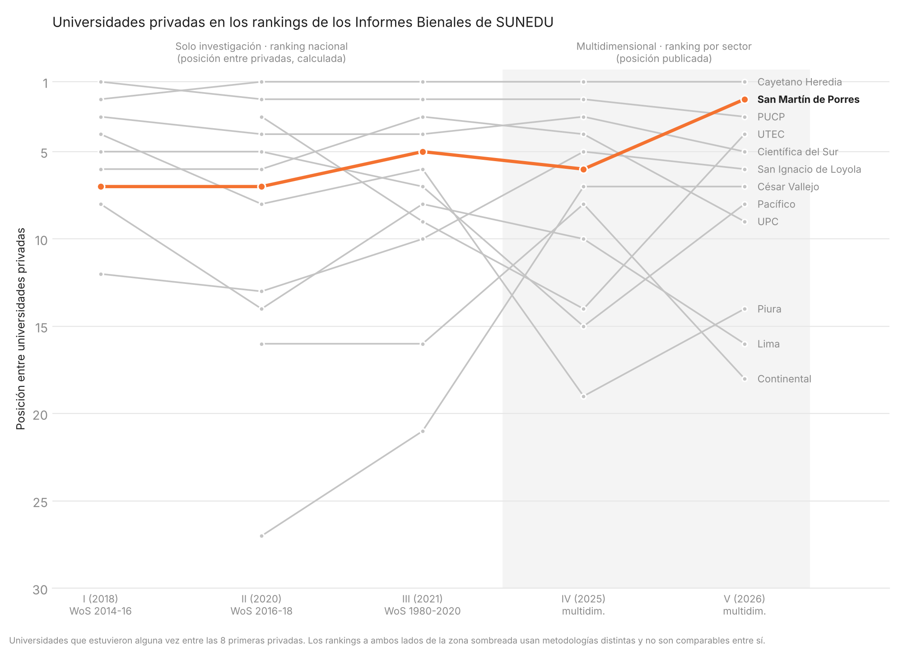

# Rankings de los Informes Bienales de SUNEDU

Serie histórica de los rankings universitarios publicados por la Superintendencia Nacional de Educación Superior Universitaria (SUNEDU) en sus cinco Informes Bienales sobre la realidad universitaria en el Perú (2018–2026). Cada ranking va con su metodología y con una evaluación de qué comparaciones admite.

> **Advertencia principal.** Cada edición usó una metodología distinta. Los puntajes **nunca** son comparables entre ediciones, y las posiciones solo lo son de forma parcial y dentro del mismo grupo metodológico. Ver [`docs/metodologia.md`](docs/metodologia.md).

## Las cinco ediciones de un vistazo

| Edición | Publicación | Datos | Qué mide | Fuente bibliométrica | Ranking | N | Grupo |
|---|---|---|---|---|---|---|---|
| I | 2018 | 2014–2016 | Investigación (4 indicadores × 6 áreas OCDE) | WoS | Nacional | 32 con puntaje > 0 | A |
| II | 2020 | 2016–2018 | Investigación (per cápita, H5, top 10%) | WoS y Scopus | Nacional | 45 / 53 | A |
| III | 2021 | 1980–2020 | Investigación acumulada + patentes | WoS | Nacional | 58 (+35 N.A.) | A |
| III (bis) | 2021 | varios | Réplica de ARWU ("Excelencia") | WoS / Clarivate | Nacional | 19 | X |
| IV | 2025 | 2018–2022 | Formativo 30% + investigación 70% (5 indicadores) | Scopus (SCImago) | Por sector | 39 públ. + 43 priv. | B |
| V | 2026* | 2023–2024 | Formativo + investigación + capacidad institucional (10 indicadores + 5 bonificadores) | Scopus (SciVal) | Por sector | 42 públ. + 45 priv. | B |

\* El V Informe aún no se ha publicado; se usan el documento del ranking y el anexo "Análisis por indicador".

Grupos: **A** = solo investigación, ranking nacional (comparabilidad parcial entre sí); **B** = multidimensional, ranking por sector (comparabilidad limitada entre sí); **X** = no comparable. A y B no son comparables entre sí.



## Estructura

```
data/
  raw/          Transcripción literal de las tablas publicadas (un archivo por ranking)
  processed/
    rankings_metodologia.csv              Ficha de cada ranking (universo, ventana, agregación, grupo)
    indicadores_metodologia.csv           Cada indicador con su peso, fuente, ventana y tipo de medida
    universidades.csv                     Identificador único (código SUNEDU cuando existe)
    alias_universidades.csv               Nombre tal como aparece en cada fuente -> id_univ
    serie_rankings_long.csv               Universidad x ranking (formato largo)
    serie_rankings_wide_posicion_en_sector.csv
    V_2026_indicadores_wide.csv           Indicadores del V por universidad
    V_2026_replica.csv, V_2026_contribuciones_por_indicador.csv, V_2026_sensibilidad_USMP.csv
docs/
  metodologia.md    Metodología detallada de cada edición y matriz de comparabilidad
  caso_usmp.md      Por qué la USMP aparece 2.ª entre las privadas en el V Informe
  fuentes.md        Documentos fuente y páginas
  diccionario.md    Variables de la serie
scripts/
  01_extraer_rankings.py        PDF/DOCX -> data/raw
  02_construir_serie.py         data/raw -> data/processed
  03_replicar_y_sensibilidad.py Réplica de los puntajes del II, IV y V, y sensibilidad
  04_grafico_trayectorias.py
output/
```

## Reproducir

```bash
pip install -r requirements.txt          # además requiere poppler-utils (pdftotext)
python scripts/01_extraer_rankings.py fuentes/   # carpeta con los PDF/DOCX (ver docs/fuentes.md)
python scripts/02_construir_serie.py
python scripts/03_replicar_y_sensibilidad.py
python scripts/04_grafico_trayectorias.py
```

## Validación

- **II-WoS** y **IV**: los puntajes publicados se reproducen a partir de los indicadores publicados (error medio de 0,07 y 0,7 puntos). Esto valida tanto la transcripción como la lectura de la metodología.
- **II-Scopus**: réplica aproximada (0,8 puntos de error medio).
- **V**: réplica sin bonificadores (no publicados por universidad), con Spearman de 0,95 en privadas y 0,99 en públicas.
- **I**: el puntaje general se reproduce exactamente a partir de los puntajes por área del Anexo F, y las 32 universidades del Anexo F coinciden con el Cuadro 4.40.
- **III**: no publicó los componentes; se transcribe tal cual (posiciones y puntajes revisados en cuanto a secuencia y monotonía).

## Hallazgos principales

1. **Ninguna metodología se repitió.** Cambiaron la fuente (WoS → Scopus/SCImago → Scopus/SciVal), la ventana (de 3 a 41 años), la estandarización (máximo → z-score), el universo y, desde el IV, la estructura (nacional → por sector).
2. **El 2.º puesto de la USMP en el V es un artefacto del indicador de impacto normalizado.** Su FWCI promedio (6,25) está 7,7 desviaciones estándar sobre la media; sin ese indicador cae al puesto 16. Ver [`docs/caso_usmp.md`](docs/caso_usmp.md).
3. **Problemas de datos en el V**: tres universidades públicas (Huancavelica, Ucayali y Del Santa) tienen 0 en todos los indicadores que dependen de docentes, al parecer por información faltante en el SIU, y ocupan los tres últimos puestos.

## Convenciones

- `id_univ` = código SUNEDU de 3 dígitos tomado de las tablas del IV Informe. Las universidades que no figuran en el IV (no licenciadas o creadas después) tienen un identificador `X-<nombre-normalizado>`.
- `posicion_en_sector`: en el IV y el V es la posición publicada; en el I, II y III es una posición **calculada** aquí, ordenando por el puntaje publicado dentro de públicas o privadas.
